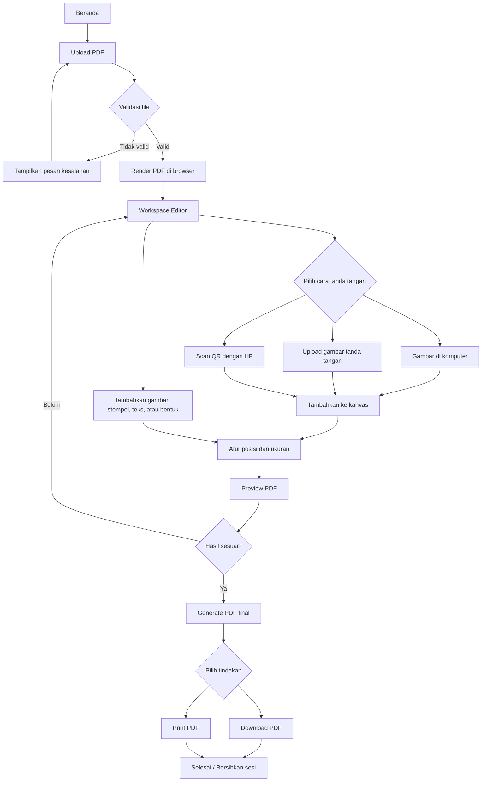
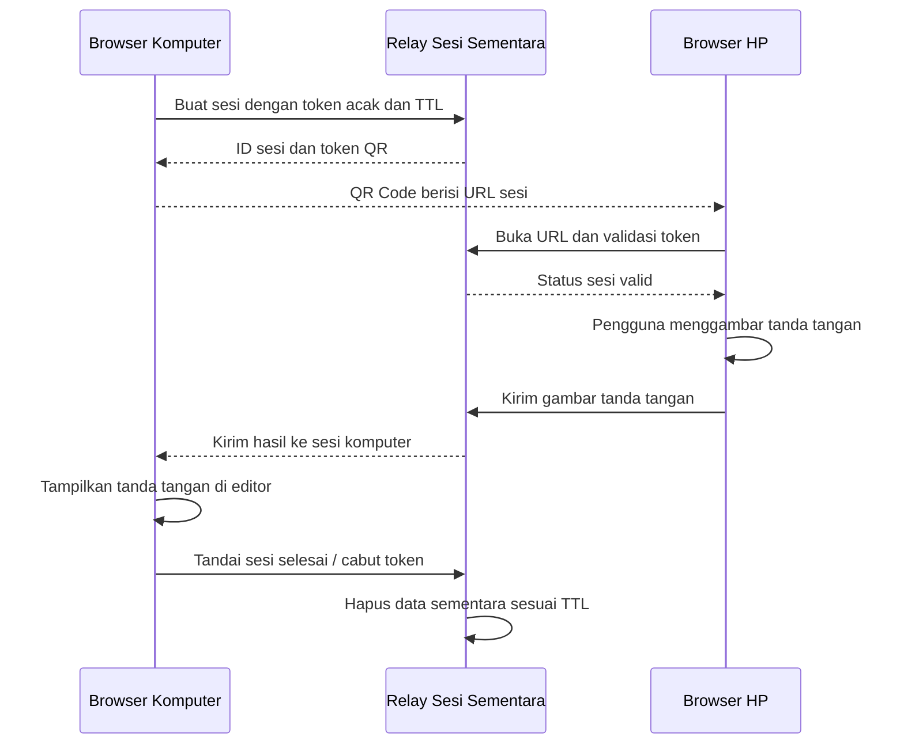

# Product Requirements Document (PRD)
## Rachita Sign — Aplikasi Tanda Tangan PDF Online

**Versi:** 1.0  
**Tanggal:** 24 Oktober 2026  
**Status:** Draft untuk validasi dan implementasi MVP

---

## 1. Ringkasan Produk

Rachita Sign adalah aplikasi berbasis web untuk menambahkan tanda tangan berupa gambar ke dokumen PDF secara online. Pengguna dapat mengunggah PDF, menggambar tanda tangan langsung di komputer, mengunggah gambar tanda tangan, menempelkan gambar atau stempel, serta membuat tanda tangan melalui ponsel dengan memindai QR Code.

Aplikasi dirancang untuk penggunaan cepat tanpa akun dan tanpa database dokumen. Pemrosesan PDF sebaiknya dilakukan langsung di browser pengguna. Dokumen final dapat diunduh atau dicetak melalui browser.

**Referensi produk dan desain:**
- PDF24 Edit PDF: https://tools.pdf24.org/id/edit-pdf
- Rachita: https://rachita.co.id/

PDF24 menjadi referensi pola interaksi editor PDF. Website Rachita menjadi acuan identitas visual. Warna HEX, logo, tipografi, dan aturan brand final harus diverifikasi dari website/aset resmi sebelum implementasi.

### 1.1 Tujuan produk
- Memudahkan pengguna menandatangani PDF tanpa mencetak dokumen terlebih dahulu.
- Memungkinkan tanda tangan dibuat di komputer atau ponsel.
- Memungkinkan pengguna menempelkan gambar, stempel, dan teks ke PDF.
- Menyediakan unduh dan cetak dokumen final.
- Meminimalkan pemrosesan dan penyimpanan data sensitif.
- Menyediakan pengalaman yang sederhana, responsif, dan mudah dipahami.

### 1.2 Pernyataan nilai
“Tambahkan tanda tangan ke PDF dengan mudah, dari komputer atau HP, lalu unduh atau cetak—tanpa akun dan tanpa menyimpan dokumen secara permanen.”

---

## 2. Sasaran dan Bukan Sasaran

### 2.1 Sasaran MVP
- Pengguna dapat membuka aplikasi tanpa login.
- Pengguna dapat mengunggah satu file PDF dan melihat halaman-halamannya.
- Pengguna dapat membuat tanda tangan melalui canvas, upload gambar, atau QR Code.
- Pengguna dapat menempatkan dan mengatur elemen pada halaman PDF.
- Pengguna dapat melihat preview dan menghasilkan PDF final.
- Pengguna dapat mengunduh serta mencetak PDF final.
- Dokumen PDF tidak disimpan di database dan, pada alur utama, tidak diunggah ke server.
- Sesi QR menggunakan data sementara dengan masa berlaku terbatas.

### 2.2 Bukan sasaran MVP
- Alur persetujuan berjenjang antardepartemen.
- Akun pengguna, dashboard riwayat, dan sinkronisasi lintas perangkat permanen.
- Penyimpanan dokumen di cloud.
- Tanda tangan digital berbasis sertifikat kriptografi.
- Verifikasi identitas atau tanda tangan elektronik tersertifikasi.
- Kolaborasi banyak penanda tangan pada satu dokumen secara bersamaan.
- OCR, konversi PDF ke Word, dan fitur PDF lanjutan lain yang tidak diperlukan untuk tanda tangan.

### 2.3 Penjelasan legal dan keamanan
Tanda tangan yang ditempelkan sebagai gambar adalah tanda tangan visual pada dokumen. Fitur tersebut tidak otomatis membuktikan identitas penanda tangan dan tidak sama dengan tanda tangan digital berbasis sertifikat atau tanda tangan elektronik tersertifikasi. Kebutuhan kepatuhan hukum harus ditinjau terpisah apabila aplikasi digunakan untuk persetujuan resmi perusahaan.

---

## 3. Target Pengguna dan Skenario

### 3.1 Target pengguna
- Karyawan yang perlu menandatangani formulir atau dokumen PDF.
- Pengguna umum yang perlu menambahkan tanda tangan, paraf, logo, atau stempel.
- Pengguna komputer yang ingin menggambar tanda tangan di HP.
- Pengguna yang membutuhkan proses cepat tanpa membuat akun.

### 3.2 Skenario utama
1. Pengguna membuka situs Rachita Sign.
2. Pengguna memilih file PDF dari perangkat.
3. Aplikasi memuat dan menampilkan PDF di editor.
4. Pengguna membuat tanda tangan melalui komputer, mengunggah gambar, atau memindai QR Code dengan HP.
5. Pengguna menempatkan tanda tangan pada halaman dan mengatur ukuran serta posisi.
6. Pengguna meninjau dokumen final.
7. Pengguna mengunduh atau mencetak PDF.
8. Pengguna menyelesaikan sesi dan aplikasi membersihkan data sementara sejauh memungkinkan.

---

## 4. App Flow

### 4.1 Flow utama



### 4.2 Flow tanda tangan melalui QR Code



**Catatan QR:** fitur lintas perangkat membutuhkan kanal komunikasi. Pilihan yang disarankan adalah relay real-time sementara, misalnya WebSocket, atau polling. Relay hanya menyimpan payload tanda tangan sementara selama sesi dan tidak menyimpan PDF. Gunakan HTTPS, token acak yang sulit ditebak, TTL, pembatasan akses, dan penghapusan payload setelah diterima atau sesi kedaluwarsa.

### 4.3 Flow tanpa QR
Jika pengguna menggambar di komputer atau mengunggah gambar tanda tangan, aplikasi tidak perlu membuat sesi relay. Seluruh alur PDF dan tanda tangan dapat berjalan lokal di browser.

---

## 5. Sitemap dan Struktur Halaman

```text
Rachita Sign
├── Beranda
│   ├── Upload PDF
│   ├── Buat Tanda Tangan
│   └── Panduan Singkat
├── Workspace Editor
│   ├── Toolbar
│   ├── Thumbnail Halaman
│   ├── Kanvas PDF
│   ├── Panel Properti Elemen
│   ├── Modal QR Signature
│   ├── Preview
│   └── Download / Print
└── Mobile Signature
    ├── Validasi Sesi QR
    ├── Canvas Tanda Tangan
    ├── Hapus / Ulangi
    └── Kirim Tanda Tangan
```

Halaman akun, riwayat dokumen, dan library tanda tangan tersimpan tidak termasuk MVP karena aplikasi tidak menggunakan database untuk dokumen.

---

## 6. Core Features dan Kebutuhan Fungsional

Prioritas:
- **P0:** wajib untuk MVP.
- **P1:** pengembangan berikutnya.
- **P2:** fitur lanjutan.

### F-01 — Upload PDF (P0)
**Deskripsi:** Pengguna memilih file PDF dari perangkat atau menyeretnya ke area upload.

**Kebutuhan:**
- Mendukung pemilihan file dan drag-and-drop.
- Memvalidasi tipe file, ukuran, dan apakah PDF dapat dibaca.
- Menampilkan nama file, ukuran file, dan jumlah halaman bila tersedia.
- Menampilkan pesan yang jelas jika file rusak, dilindungi kata sandi, atau tidak didukung.
- Menyediakan tindakan ganti file dan hapus dokumen dari sesi.

**Kriteria penerimaan:**
- File PDF valid dapat dibuka di editor.
- File yang tidak didukung ditolak dengan pesan yang mudah dimengerti.
- Upload lokal tidak menyebabkan PDF dikirim ke server pada alur utama.

### F-02 — PDF Editor (P0)
**Deskripsi:** Area kerja utama untuk melihat PDF dan meletakkan elemen tanda tangan.

**Kebutuhan:**
- Render halaman PDF dan menyediakan navigasi halaman.
- Menyediakan zoom in/out, fit-to-page, serta thumbnail.
- Menampilkan elemen yang dapat dipilih.
- Menyediakan undo/redo untuk perubahan editor.
- Mempertahankan posisi relatif elemen saat zoom berubah.
- Menampilkan indikator halaman aktif dan status proses.

**Kriteria penerimaan:**
- Pengguna dapat berpindah halaman dan melihat halaman terpilih.
- Elemen tetap berada di lokasi yang benar ketika zoom berubah.
- Perubahan dapat dibatalkan dan diulangi sesuai riwayat editor.

### F-03 — Membuat Tanda Tangan di Komputer (P0)
**Deskripsi:** Pengguna menggambar tanda tangan menggunakan mouse, touchpad, stylus, atau layar sentuh.

**Kebutuhan:**
- Canvas dengan latar transparan.
- Tombol Hapus/Clear dan Ulangi bila diperlukan.
- Pengaturan ketebalan goresan dan warna dasar.
- Preview sebelum tanda tangan diterapkan.
- Tanda tangan dapat ditempatkan sebagai elemen pada PDF.

**Kriteria penerimaan:**
- Pengguna dapat menggambar dan menghapus tanda tangan.
- Hasil tanda tangan dapat ditambahkan ke halaman PDF.
- Area kosong tidak menghasilkan kotak latar putih yang tidak diinginkan.

### F-04 — Upload Gambar Tanda Tangan (P0)
**Deskripsi:** Pengguna mengunggah gambar tanda tangan yang sudah ada.

**Kebutuhan:**
- Mendukung format gambar yang disepakati, minimal PNG dan JPEG.
- Menampilkan preview gambar.
- Mempertahankan transparansi PNG.
- Menyediakan penghapusan gambar dari sesi.
- Penghapusan latar belakang dapat disediakan sebagai fitur opsional.

**Kriteria penerimaan:**
- Gambar valid dapat ditambahkan ke editor.
- Transparansi PNG dipertahankan jika format dan proses mendukungnya.
- Gambar hanya berada di memori browser pada alur utama.

### F-05 — Tanda Tangan melalui QR Code (P0)
**Deskripsi:** Pengguna menggambar tanda tangan di HP dan mengirimkannya ke editor komputer.

**Kebutuhan:**
- Tombol “Tanda Tangan via HP” pada editor.
- QR Code mengarah ke halaman mobile dengan token sesi acak.
- Status sesi terlihat di komputer: menunggu, diterima, kedaluwarsa, atau dibatalkan.
- Halaman HP menyediakan canvas, clear, ulangi, dan kirim.
- Tanda tangan diterima di komputer tanpa refresh manual jika koneksi tersedia.
- Token memiliki masa berlaku yang singkat, misalnya 5 menit, dan dapat dicabut.
- Sesi selesai tidak dapat digunakan kembali.
- Jika koneksi gagal, tampilkan instruksi mencoba ulang atau membuat QR baru.

**Kriteria penerimaan:**
- QR valid membuka halaman tanda tangan di HP.
- Hasil tanda tangan yang dikirim muncul di editor komputer.
- Token kedaluwarsa atau dicabut tidak dapat mengirim data.
- PDF asli tidak dikirim ke relay QR.
- Payload tanda tangan di relay dihapus setelah diterima atau saat sesi berakhir sesuai kebijakan TTL.

### F-06 — Tempel Gambar, Logo, dan Stempel (P0)
**Deskripsi:** Pengguna menambahkan gambar non-tanda tangan ke PDF.

**Kebutuhan:**
- Menambahkan gambar dari perangkat.
- Memindahkan, mengubah ukuran, dan memutar gambar.
- Menghapus atau menduplikasi elemen.
- Mengatur opacity bila diperlukan.
- Menampilkan batas elemen saat dipilih.

**Kriteria penerimaan:**
- Gambar dapat ditempatkan pada halaman yang dipilih.
- Ukuran dan posisi yang terlihat di editor sesuai dengan hasil ekspor.
- Gambar dapat dihapus sebelum ekspor.

### F-07 — Teks dan Anotasi (P0)
**Deskripsi:** Pengguna menambahkan teks dan bentuk sederhana ke PDF.

**Kebutuhan:**
- Menambahkan teks dengan pilihan ukuran font dan warna.
- Menambahkan garis, panah, kotak, lingkaran, atau coretan bebas sesuai kemampuan implementasi.
- Memindahkan, mengubah ukuran jika relevan, dan menghapus elemen.
- Menampilkan preview hasil.

**Kriteria penerimaan:**
- Teks dan bentuk muncul pada halaman yang benar di hasil ekspor.
- Pengguna dapat mengubah atau menghapus elemen sebelum ekspor.

### F-08 — Preview dan Generate PDF Final (P0)
**Deskripsi:** Aplikasi menerapkan semua elemen editor ke PDF final.

**Kebutuhan:**
- Menyediakan preview sebelum ekspor.
- Mempertahankan urutan dan jumlah halaman dokumen asli.
- Menyematkan tanda tangan, gambar, teks, dan bentuk ke halaman yang sesuai.
- Menggunakan koordinat halaman PDF yang konsisten dengan tampilan editor.
- Menampilkan indikator proses dan kesalahan ekspor.
- Tidak menimpa file asli di perangkat.

**Kriteria penerimaan:**
- Hasil PDF dapat dibuka di pembaca PDF umum.
- Elemen muncul pada halaman dan posisi yang tepat.
- Dokumen asli tidak berubah.
- Jika ekspor gagal, pengguna mendapat pesan dan dapat mencoba kembali.

### F-09 — Download PDF (P0)
**Deskripsi:** Pengguna mengunduh dokumen final ke perangkat.

**Kebutuhan:**
- Tombol “Download PDF” mudah ditemukan.
- Nama file keluaran jelas, misalnya `dokumen-ditandatangani.pdf`.
- Unduhan dipicu dari PDF final yang telah dihasilkan.
- URL objek sementara dilepas setelah tidak dibutuhkan.

**Kriteria penerimaan:**
- Browser mengunduh file PDF final.
- File yang diunduh berisi perubahan yang ditampilkan di preview.
- Tidak ada kebutuhan menyimpan file di database atau akun.

### F-10 — Print PDF (P0)
**Deskripsi:** Pengguna mencetak PDF final melalui dialog cetak browser.

**Kebutuhan:**
- Tombol “Print PDF” tersedia setelah dokumen siap.
- Mencetak dokumen final, bukan toolbar atau antarmuka editor.
- Menggunakan halaman cetak khusus atau membuka PDF final untuk dicetak.
- Mengatur CSS cetak agar ukuran halaman dan orientasi mengikuti dokumen.
- Menampilkan petunjuk jika browser memblokir popup atau dialog cetak.

**Kriteria penerimaan:**
- Dialog cetak browser dapat dibuka.
- Konten yang dicetak adalah PDF final dan bukan UI aplikasi.
- Tata letak halaman tidak terpotong karena elemen antarmuka.

### F-11 — Pembersihan Sesi dan Privasi (P0)
**Deskripsi:** Menghapus data sementara setelah proses selesai sejauh memungkinkan.

**Kebutuhan:**
- Tombol “Selesai / Dokumen Baru” membersihkan dokumen dan elemen editor dari memori aplikasi.
- Mencabut sesi QR dan menghapus payload relay sesuai TTL.
- Melepaskan object URL dan event listener yang tidak lagi diperlukan.
- Tidak menyimpan PDF atau gambar tanda tangan di database.
- Tidak menyimpan dokumen ke localStorage atau IndexedDB secara otomatis.
- Menyediakan pemberitahuan privasi yang menjelaskan batas pemrosesan lokal dan sesi QR.
- Menghindari pengiriman isi dokumen atau tanda tangan ke layanan analitik/log.

**Kriteria penerimaan:**
- Setelah sesi dibersihkan, dokumen tidak lagi tersedia melalui UI aplikasi.
- Token QR lama tidak dapat digunakan lagi.
- Alur utama tidak mengirim PDF ke server.
- Batasan pembersihan memori browser dijelaskan secara akurat; aplikasi tidak mengklaim dapat menghapus semua jejak sistem operasi, swap, screenshot, atau salinan yang dibuat pengguna.

### F-12 — Riwayat dan Signature Library (P1, di luar MVP)
**Deskripsi:** Penyimpanan tanda tangan atau riwayat untuk pengguna yang login.

**Catatan:** Fitur ini membutuhkan keputusan produk dan mekanisme penyimpanan tambahan. Tidak boleh diaktifkan pada MVP tanpa mengubah prinsip tanpa database dan tanpa penyimpanan permanen.

### F-13 — Approval dan Audit Trail (P2, di luar MVP)
**Deskripsi:** Workflow persetujuan, identitas penanda tangan, timestamp, audit trail, dan integrasi layanan tanda tangan elektronik tersertifikasi.

---

## 7. Rancangan UI/UX

### 7.1 Prinsip desain
- Profesional, bersih, dan mudah dipahami.
- Mengacu pada identitas visual Rachita.
- PDF menjadi fokus utama di halaman editor.
- Tombol utama memiliki label yang jelas.
- Responsif untuk desktop, tablet, dan HP.
- Aksesibilitas dasar: kontras warna memadai, fokus keyboard, label tombol, dan pesan kesalahan yang jelas.

### 7.2 Halaman beranda
Komponen:
- Logo dan nama produk.
- Headline singkat yang menjelaskan manfaat.
- Area upload PDF dengan drag-and-drop.
- Tombol pilih file.
- Akses cepat ke “Buat Tanda Tangan”, “Edit PDF”, dan panduan.
- Penjelasan privasi: dokumen diproses lokal jika memungkinkan dan tidak disimpan permanen oleh aplikasi.

### 7.3 Workspace editor
Komponen:
- **Header:** logo, nama file, status dokumen, undo/redo, dan tombol selesai.
- **Toolbar:** pilih, tanda tangan, gambar, teks, stempel, bentuk, dan QR Signature.
- **Sidebar:** thumbnail halaman dan navigasi halaman.
- **Kanvas utama:** halaman PDF yang sedang aktif.
- **Panel properti:** posisi, ukuran, rotasi, opacity, warna, atau font berdasarkan elemen terpilih.
- **Footer/action bar:** Preview, Download PDF, dan Print PDF.

### 7.4 Halaman tanda tangan mobile
Komponen:
- Identitas aplikasi dan status sesi.
- Area canvas besar yang nyaman untuk jari.
- Tombol Hapus, Ulangi, dan Kirim Tanda Tangan.
- Informasi masa berlaku sesi.
- Pesan sukses atau gagal yang jelas.
- Tidak menampilkan atau mengunduh dokumen PDF karena HP hanya bertugas mengirim gambar tanda tangan.

### 7.5 Design tokens
Gunakan warna, logo, dan tipografi resmi Rachita setelah diverifikasi. Selama belum diverifikasi, gunakan token sementara yang mudah diganti:
- `--color-primary`: warna brand utama.
- `--color-primary-hover`: variasi hover warna utama.
- `--color-accent`: warna aksen untuk tombol penting.
- `--color-background`: latar netral.
- `--color-surface`: permukaan panel dan kartu.
- `--color-text`: teks utama.
- `--color-muted`: teks sekunder.
- `--color-border`: garis pemisah.
- `--color-danger`: error dan tindakan destruktif.
- `--radius-card`, `--radius-control`, `--spacing-*`: token layout.

Jangan menganggap warna mockup sementara sebagai warna resmi brand sebelum verifikasi.

---

## 8. Arsitektur Teknis yang Disarankan

### 8.1 Prinsip arsitektur
**Browser-first / local processing:** file PDF asli, gambar tanda tangan, dan hasil PDF diproses di browser pengguna pada alur utama. Backend hanya digunakan jika diperlukan untuk menghubungkan tanda tangan dari HP melalui QR Code.

### 8.2 Komponen teknologi
| Area | Rekomendasi | Tanggung jawab |
|---|---|---|
| Frontend | React + TypeScript | UI, state editor, alur pengguna |
| Styling | Tailwind CSS atau sistem CSS yang konsisten | Layout dan desain responsif |
| Render PDF | PDF.js | Membaca dan merender halaman PDF |
| Manipulasi PDF | pdf-lib | Menempelkan gambar/teks dan menghasilkan PDF |
| Signature canvas | HTML Canvas / Pointer Events | Menggambar dengan mouse, stylus, atau jari |
| QR Code | Library QR Code yang terawat | Menghasilkan QR URL sesi |
| Relay QR | WebSocket atau polling dengan TTL | Mengirim gambar tanda tangan sementara dari HP ke PC |
| Database | Tidak digunakan untuk dokumen | Tidak ada tabel dokumen atau tanda tangan |
| Download | Blob URL / browser download | Mengunduh PDF final |
| Print | Dialog browser atau halaman cetak khusus | Mencetak PDF final |

### 8.3 Data flow lokal
1. File dipilih melalui file picker.
2. Browser membaca file sebagai data lokal.
3. PDF.js merender halaman untuk editor.
4. Aplikasi menyimpan elemen editor di memori sesi.
5. pdf-lib menerapkan elemen ke PDF.
6. Browser membuat Blob PDF final.
7. Blob digunakan untuk download atau print.
8. Data aplikasi dibersihkan ketika sesi berakhir atau pengguna memilih Dokumen Baru.

### 8.4 Data flow QR
1. Komputer meminta pembuatan sesi sementara.
2. Relay membuat token acak dengan TTL dan memberikan URL sesi.
3. QR berisi URL/token sesi, bukan isi PDF.
4. HP membuka URL dan menggambar tanda tangan.
5. HP mengirim gambar tanda tangan ke relay.
6. Relay meneruskan payload ke sesi komputer.
7. Komputer memasukkan tanda tangan ke editor.
8. Sesi dicabut dan payload dihapus setelah diterima atau saat TTL berakhir.

### 8.5 Batasan arsitektur
- Fitur QR antarperangkat memerlukan koneksi internet dan komponen relay, kecuali kedua perangkat menggunakan solusi komunikasi lokal khusus.
- Relay dapat memproses payload tanda tangan sementara. Karena itu, jangan menjanjikan bahwa tidak ada data apa pun yang pernah melewati server.
- Jangan mengunggah PDF ke relay QR.
- Jangan menyimpan PDF/tanda tangan ke database, log, analytics, cache persisten, localStorage, atau IndexedDB.
- Jika menggunakan server untuk relay, konfigurasi logging agar tidak merekam token sensitif atau payload tanda tangan.
- Batasi ukuran file dan jumlah halaman agar penggunaan memori browser tetap wajar.
- PDF yang dienkripsi, rusak, atau memiliki fitur khusus mungkin tidak dapat diproses; tampilkan pesan yang sesuai.
- Jangan menyatakan bahwa penghapusan data dari memori browser dapat menghapus semua jejak di sistem operasi atau salinan yang dibuat pengguna.

---

## 9. Kebutuhan Non-Fungsional

### NFR-01 — Privasi
- Pemrosesan PDF lokal menjadi default.
- Tidak ada penyimpanan dokumen permanen.
- Tidak ada akun wajib.
- Tidak mengirim isi PDF ke analytics.
- Kebijakan privasi menjelaskan alur QR dan relay.

### NFR-02 — Keamanan
- HTTPS wajib untuk penggunaan produksi.
- Validasi file dan payload di sisi klien serta server relay.
- Token sesi acak, berumur pendek, dapat dicabut, dan sekali pakai.
- Pembatasan ukuran payload, rate limit, dan perlindungan terhadap penyalahgunaan endpoint.
- Hindari menaruh token sensitif di log.
- Terapkan Content Security Policy dan praktik keamanan web yang sesuai.

### NFR-03 — Kinerja
- Tampilkan indikator loading saat PDF dirender dan diekspor.
- Hindari memuat semua halaman beresolusi tinggi sekaligus jika dokumen besar.
- Tetapkan batas ukuran file yang dapat dikonfigurasi.
- Jangan membekukan UI ketika operasi berat; gunakan worker bila sesuai.
- Tetapkan target kinerja setelah pengujian pada perangkat dan ukuran PDF representatif.

### NFR-04 — Kompatibilitas
- Mendukung versi terbaru browser desktop dan mobile yang disepakati, minimal Chrome/Edge dan Safari mobile yang masih didukung.
- Editor responsif dan halaman QR nyaman digunakan di layar sentuh.
- Tampilkan pesan yang jelas untuk browser yang tidak mendukung fitur yang dibutuhkan.

### NFR-05 — Aksesibilitas dan usability
- Kontrol penting dapat digunakan melalui keyboard.
- Tombol memiliki label yang jelas.
- Fokus dan kontras warna terlihat.
- Error, loading, sukses, dan status QR ditampilkan dengan jelas.

### NFR-06 — Keandalan ekspor
- PDF final dapat dibuka di pembaca PDF umum.
- Posisi elemen harus konsisten antara editor, preview, hasil download, dan hasil cetak.
- Kegagalan ekspor tidak boleh menghapus PDF sumber dari memori sesi.

---

## 10. Aturan Bisnis

1. MVP tidak mewajibkan login.
2. Satu sesi editor menangani satu dokumen aktif pada satu waktu.
3. File sumber tidak ditimpa; hasil dibuat sebagai PDF baru.
4. Pengguna harus memeriksa preview sebelum mengunduh atau mencetak.
5. Tanda tangan QR hanya berlaku untuk sesi yang membuat QR tersebut.
6. Token QR kedaluwarsa setelah TTL atau dicabut setelah penggunaan.
7. Dokumen PDF tidak disimpan di database.
8. PDF tidak diunggah ke server pada alur utama.
9. Data relay QR hanya sementara dan dihapus sesuai kebijakan TTL.
10. Pengguna bertanggung jawab memastikan hak dan kewenangan untuk menandatangani dokumen.
11. Tanda tangan gambar tidak boleh dipresentasikan sebagai tanda tangan digital tersertifikasi.

---

## 11. Acceptance Criteria MVP

MVP dinyatakan siap untuk uji pengguna apabila seluruh kondisi berikut terpenuhi:

- [ ] PDF valid dapat diunggah tanpa akun.
- [ ] PDF dapat dirender dan halaman dapat dinavigasi.
- [ ] Pengguna dapat menggambar tanda tangan di komputer.
- [ ] Pengguna dapat mengunggah gambar tanda tangan PNG/JPEG.
- [ ] Pengguna dapat membuat tanda tangan di HP melalui QR.
- [ ] Tanda tangan dari HP muncul di editor komputer.
- [ ] Pengguna dapat menambahkan gambar, stempel, teks, dan bentuk yang didukung.
- [ ] Elemen dapat dipindahkan, diubah ukurannya, dan dihapus.
- [ ] Preview sesuai dengan PDF final.
- [ ] PDF final dapat diunduh dan dibuka.
- [ ] Dialog print mencetak dokumen final, bukan antarmuka editor.
- [ ] Dokumen PDF tidak diunggah atau disimpan ke database pada alur utama.
- [ ] Tidak ada penyimpanan otomatis PDF/tanda tangan di localStorage atau IndexedDB.
- [ ] Sesi QR memiliki TTL dan token tidak dapat digunakan kembali setelah selesai.
- [ ] Payload relay dihapus setelah diterima atau kedaluwarsa sesuai kebijakan.
- [ ] Pengguna dapat menghapus sesi dan memulai dokumen baru.
- [ ] Error file tidak valid, koneksi QR gagal, dan ekspor gagal ditangani dengan pesan yang jelas.
- [ ] Tampilan responsif pada desktop dan mobile.
- [ ] Warna serta logo final sudah diverifikasi terhadap identitas visual Rachita.

---

## 12. Risiko dan Mitigasi

| Risiko | Dampak | Mitigasi |
|---|---|---|
| PDF berukuran besar | Browser lambat atau kehabisan memori | Batas ukuran/halaman, render bertahap, indikator proses |
| PDF terenkripsi atau rusak | Tidak bisa dibuka atau diekspor | Deteksi dan tampilkan instruksi yang jelas |
| Koneksi QR terputus | Tanda tangan tidak sampai ke komputer | Status koneksi, retry, buat sesi baru |
| QR dibuka orang yang tidak berwenang | Penyalahgunaan sesi | Token acak, TTL singkat, sekali pakai, cabut sesi |
| Payload tanda tangan tertinggal di relay | Risiko privasi | TTL, penghapusan setelah diterima, minimisasi log |
| Hasil ekspor bergeser | Dokumen tidak akurat | Konversi koordinat konsisten dan pengujian berbagai ukuran halaman |
| Print memotong elemen | Hasil cetak berbeda dari preview | Cetak PDF final, bukan DOM editor; uji CSS/print flow |
| Warna brand tidak akurat | UI tidak sesuai identitas Rachita | Verifikasi aset dan design token resmi sebelum rilis |

---

## 13. Metrik Keberhasilan

Metrik berikut merupakan target awal untuk diuji dan disepakati, bukan hasil yang sudah terukur:

- Tingkat keberhasilan upload PDF.
- Tingkat keberhasilan proses tanda tangan sampai ekspor.
- Tingkat keberhasilan transfer tanda tangan melalui QR.
- Persentase ekspor PDF yang berhasil.
- Waktu rata-rata dari upload hingga download.
- Jumlah kegagalan render, ekspor, dan koneksi QR.
- Jumlah sesi QR kedaluwarsa atau dibatalkan.
- Hasil pengujian yang membuktikan PDF tidak dikirim ke server pada alur utama.

Pengumpulan metrik harus meminimalkan data dan tidak merekam isi PDF, gambar tanda tangan, atau token sesi.

---

## 14. Rencana Implementasi Bertahap

### Tahap 1 — Fondasi dan upload
- Setup proyek frontend.
- Implementasi design tokens dan layout responsif.
- Upload PDF lokal dan render PDF.
- Navigasi halaman, thumbnail, dan zoom.

### Tahap 2 — Editor dan tanda tangan
- Canvas tanda tangan desktop.
- Upload gambar tanda tangan.
- Tambah gambar, teks, dan bentuk.
- Drag, resize, rotate, undo/redo.

### Tahap 3 — Ekspor, download, dan print
- Integrasi manipulasi PDF.
- Preview final.
- Download Blob PDF.
- Print PDF final.
- Pengujian posisi elemen pada berbagai ukuran halaman.

### Tahap 4 — QR Signature
- Backend relay sesi sementara.
- Pembuatan token dan QR.
- Halaman tanda tangan mobile.
- Transfer tanda tangan real-time.
- TTL, pencabutan sesi, dan pembersihan payload.

### Tahap 5 — QA dan rilis
- Uji browser desktop dan mobile.
- Uji PDF besar, rusak, dan terenkripsi.
- Uji privasi serta keamanan QR.
- Verifikasi identitas visual Rachita.
- Uji pengguna dan perbaikan bug.

---

## 15. Keputusan Produk yang Perlu Dikonfirmasi

Sebelum implementasi, konfirmasikan hal berikut:
1. Batas ukuran PDF dan jumlah halaman yang akan didukung.
2. Apakah pengguna boleh menambahkan banyak tanda tangan pada satu dokumen.
3. Apakah penghapusan latar belakang gambar tanda tangan diperlukan pada MVP.
4. Apakah QR relay boleh menggunakan backend ringan sementara atau harus sepenuhnya tanpa server.
5. Apakah fitur cetak harus langsung membuka dialog browser atau menyediakan halaman print khusus.
6. Logo, warna HEX, dan font resmi Rachita untuk design system final.

---

## 16. Ringkasan MVP

MVP Rachita Sign mencakup:

- Upload PDF lokal tanpa login.
- Render dan navigasi halaman PDF.
- Tanda tangan dengan mouse/touchpad.
- Upload gambar tanda tangan.
- Tanda tangan melalui HP menggunakan QR Code.
- Tempel gambar, stempel, teks, dan bentuk.
- Atur posisi, ukuran, dan rotasi elemen.
- Preview PDF final.
- Download PDF.
- Print PDF.
- Pembersihan sesi dan relay QR sementara.
- Tidak ada database dokumen dan tidak ada penyimpanan permanen oleh aplikasi pada alur utama.

**Prinsip utama:** PDF tetap di browser pengguna. Backend hanya digunakan untuk relay tanda tangan lintas perangkat bila fitur QR diaktifkan, dengan token dan payload sementara yang kedaluwarsa serta dihapus sesuai kebijakan.
